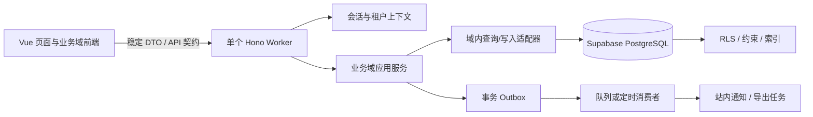

# 功能模块化与高性能架构

> 状态：已定方案。本文将目标站证据、本项目已确认约束与本项目设计决定分开记录。目标站未验证的行为不作为事实；本方案决定用于指导后续实现。

## 1. 结论

采用**模块化单体（modular monolith）**：前端按业务域垂直切片，后端仍部署为一个 Hono/Cloudflare Worker，数据库继续使用 Supabase PostgreSQL。每个业务域通过清晰的应用服务/API 契约交互；跨域写入仅经显式用例编排，资金与审批等强一致操作在 PostgreSQL 单事务/RPC 内完成。

当前不拆微服务、不先建通用工作流引擎、不为猜测的流量加缓存或读副本。高性能从减少往返、限定查询、索引与执行计划、异步化重任务和可观测指标入手，达到真实瓶颈后再优化。

## 2. 依据与边界

| 分类 | 依据或决定 | 设计影响 |
|---|---|---|
| 目标站 UI/请求证据 | [功能模块地图](../../../Docs/FUNCTIONAL_MODULE_MAP.html)、[复刻规格](../../../Docs/REPLICATION_SPEC.md) §11–12 | 可说明观察到的页面/操作及缺口，不能证明目标站内部代码、服务划分或物理表结构。 |
| 本项目产品需求 | [需求规格](../../../Docs/REQUIREMENTS.md) §4–12、§16–18、§21–26 | CRM 转化幂等、财务原子性、租户和数据范围校验、统一统计口径、P95 性能目标是本项目需求。 |
| 当前项目架构 | [ARCHITECTURE.md](../../../ARCHITECTURE.md)、[TECH_SELECTION.md](../../../Docs/TECH_SELECTION.md) | Vue 3 → Hono Worker → Supabase PostgreSQL；RLS 与服务端授权并用；首期单 Worker；对象存储暂缓。 |
| 推导设计 | 本文第 3–8 节 | 为满足当前需求确定的实现边界，不声称复刻目标站内部做法。 |
| 本项目默认决策 | 首期容量、业务范围和非目标能力见第 9 节 | 用可复现的容量剖面指导实现和验收；不把容量假设写成目标站事实。 |

需求 §22 已给出目标：普通列表/详情 API 服务端 P95 < 800 ms、复杂报表 P95 < 3 s、超过 3 s 的导出异步化。为补足容量验收条件，第 9 节定义本项目首期工程容量剖面。该剖面是本方案的可执行测试基线，不是对目标站或真实客户规模的描述。Cloudflare CPU 时间与端到端耗时不同：等待数据库/网络不等于 Worker CPU；应分别观测 Worker CPU、请求耗时和数据库查询耗时。[Workers limits](https://developers.cloudflare.com/workers/platform/limits/)、[Workers observability](https://developers.cloudflare.com/workers/observability/metrics-and-analytics/)

## 3. 目标架构



主请求路径保持短小：身份上下文与权限验证 → 参数校验 → 一个明确的用例服务 → 一次有界的数据访问/事务 → DTO 响应。跨域操作由用例协调；业务模块不能直接导入其他模块的内部 Repository。读取与写入可采用同域的不同服务/查询模型，不引入必须保持同步的第二份事实数据。

## 4. 模块边界

| 模块 | 责任与数据边界 | 允许的跨模块协作 |
|---|---|---|
| Identity & Access | 用户、会话、角色、权限、组织上下文；提供可信 actor/tenant/scope | 所有受保护用例依赖其上下文；不接管业务数据授权判断。 |
| Master Data | 客户、供应商、线路、地区、字典 | CRM/订单只通过公开服务/API 契约读取或创建；订单保留历史快照。 |
| CRM | 线索、公海、跟进、线索转换 | `ConvertLead` 用例调用 Master Data/Order 公开接口；重复提交靠数据库唯一约束和幂等记录收敛。 |
| Orders | 订单、状态机、团期、游客、订单金额快照、回收站 | 订单创建编排客户/线路选择；财务项目由同事务用例初始化或经明确领域事件处理。 |
| Finance & Approval | 应收/应付项目、申请、审批实例/动作、资金流水、账户余额口径、结算 | 对订单额度的读取/占用在同一事务中；审批最终确认和账务流水必须原子提交。 |
| Analytics & Workspace | 仪表盘摘要、列表型报表、业绩、导出 | 只读调用统一查询服务/SQL 聚合；展示、报表和导出共用口径与权限过滤。 |
| Notification | 站内通知、收件人、已读状态、待投递事件 | 消费事务 Outbox；通知失败不能回滚已完成的业务交易。 |
| Settings & Audit | 版本化公司配置、审计记录 | 业务域消费带版本的配置；敏感变化写审计并按需求做二次确认。 |
| File capability（首期排除） | 文件授权、元数据、对象键、配额与下载 | R-FILE-01 不进入当前功能实现阶段；本方案不接七牛 SDK、不做上传/下载，附件仅保留需求接口占位，直到后续独立版本范围启动。 |

模块是代码与责任边界，不代表每个模块都单独部署或拥有独立数据库。首期共享一个 PostgreSQL schema；表按业务域归属，跨域外键/事务由明确用例控制。实际 schema 只能由 migration 定义，不能从地图或目标站页面反推。

### 代码依赖方向

```text
apps/web/src/features/<domain>  -> packages/contracts
apps/api/src/modules/<domain>/routes -> application -> domain
                                      application -> domain-owned ports
apps/api/src/adapters/* -------------------------> ports
supabase/migrations ------------------------------> physical schema / RLS / RPC
```

- 路由只做协议适配和授权上下文注入，不包含财务公式或状态迁移规则。
- Domain 不依赖 Vue、Hono、Supabase SDK 或第三方供应商 SDK。
- `packages/contracts` 只放稳定的 API DTO、错误码与权限标识；不把数据库实体原样透传到浏览器。
- 模块间使用公开 application API / typed event；禁止读取对方私有表访问层或深层路径。
- 避免“通用 CRUD / BaseRepository / 万能事件总线”；只有存在多个真实调用方和稳定语义时才抽公共能力。

## 5. 关键用例设计（均为本项目方案）

### 5.1 CRM 线索转客户/订单

提供命令式 `convertLead` 用例：检查租户、权限、线索状态及版本 → 按产品规则处理重复客户（提示关联或继续创建）→ 原子创建/关联客户并记录转换结果 → 如用户明确选择则创建订单。请求携带幂等键，数据库对“同一租户、同一线索的成功转换”设置唯一约束；并发重试返回首次结果或稳定冲突。禁止因转换默认创建多个对象。需求依据：R-CRM-02；目标站成功链尚未被证据验证。

### 5.2 订单与生命周期

创建/编辑使用字段白名单 DTO；服务端从可信租户上下文装配主数据快照并重算金额。状态变更走显式命令（确认出团、锁团、解锁、取消、恢复），带 `expectedVersion`/条件更新，检查关联财务状态并记录状态历史/审计。普通文本编辑不能覆盖业务状态、已确认金额或历史快照。游客 CSV 先解析与预览，再按需求定义整批事务提交。

### 5.3 收付款和审批

创建申请、占用额度、推进审批、确认流水是不同命令，但各自不可分割。额度判断与更新在同一 PostgreSQL 事务中通过行锁/约束或等价并发控制完成；审批动作追加写入；以幂等键和申请版本拒绝重复点击/旧版本操作。终审、确认金额、不可变账务流水、余额来源以及 Outbox 事件在一个事务内提交。撤回/冲正新增反向流水，绝不改写已确认历史。余额以流水聚合为真源；如将来引入账户汇总表，只能作为事务内维护且可对账重建的投影。

依据：R-FIN-01–03、R-APPROVAL-01–02、R-BALANCE-01、R-SETTLE-01；其中终审自动确认/撤回配置按当前需求契约实现，不推断目标站内部机制。

### 5.4 仪表盘、报表和导出

- 页面按需请求少量聚合 DTO，不逐卡片发起串行 N+1 请求；允许并行的独立摘要并行加载，故障可以逐区重试。
- 列表采用服务端筛选、确定性排序和有界分页；所有查询显式带可信租户及数据范围条件。大页码场景评估 keyset pagination；不得为了抽象而改动当前契约。
- 仪表盘、报表、CSV 导出共用服务端口径/SQL 函数，筛选条件和可见数据范围一致；金额、状态和时间口径有版本化测试样例。
- 对复杂统计优先检查查询计划、谓词和聚合范围；有真实数据测量后再决定索引、汇总表或物化视图。物化/预计算必须有刷新时限、过期标识、租户隔离和对账路径。
- 大导出创建任务并返回 job ID；后台按租户、过滤器快照、权限策略执行，状态可查、失败可重试、重复任务可去重。下载时重新校验操作者权限并设置短时效。阈值沿用需求 §22 的 3 秒目标，通过实测定义触发方式。

### 5.5 通知与异步任务

业务事务写入 Outbox 事件；消费者幂等处理并记录重试次数/最终失败。首期采用 Cloudflare Cron 定时触发同一 Worker 的 Outbox 处理器，不增加 Queue 产品绑定和部署依赖。通知只承担 R-NOTIFY-01 的站内提醒；不发外部短信/邮件/企业微信。一次通知消费者失败不重复确认财务交易。导出任务复用同一任务表和轮询处理器。

### 5.6 配置与审计

配置以类型化版本记录；高风险用例读取单一版本快照，审批在途实例保存配置快照。审计记录关联 request ID、操作者、租户、动作、对象和安全摘要，不保存凭证、完整证件号、Cookie、Token 或附件正文。审计应与高风险写入同事务。

## 6. 性能设计与验证门槛

### 请求与数据访问

1. **控制往返**：页面按用户可见区组合查询；命令一次请求完成所有一致性写入；API 批量接口设上限并逐对象校验权限。
2. **控制扫描和排序**：过滤器有白名单/类型/范围；查询列与排序稳定；按租户、业务状态、日期、负责人等真实查询模式逐条用 `EXPLAIN (ANALYZE, BUFFERS)` 验证。索引根据 workload 增加，兼顾写放大与存储，而非按字段全部建索引。PostgreSQL 文档建议依据真实索引使用与执行计划判断索引是否有效。[Index usage](https://www.postgresql.org/docs/current/indexes-examine.html)
3. **RLS 友好查询**：策略表达式简单、策略过滤列有索引；对与行无关的身份辅助函数采用 Supabase 文档建议的语句级求值形式，并检查真实执行计划。[Supabase RLS 性能建议](https://supabase.com/docs/guides/database/postgres/row-level-security#rls-performance-recommendations)
4. **限制载荷**：列表不返回详情级字段；附件内容不经过 JSON API 内存缓冲；大文件/导出采用流式或异步链路（附件集成仍受 R-FILE-01 限制）。
5. **并发正确性优先**：财务/审批不可通过易失缓存判断额度；冲突使用数据库约束、锁或版本条件并映射为稳定 409。后台投递允许至少一次执行，消费端幂等。

### 必需测量

以第 9 节规定的固定工程容量剖面准备双租户列表/详情/财务并发/报表数据集，记录：API P50/P95/P99、Worker CPU 与请求耗时、数据库语句 P95/扫描行数、错误率、锁等待、导出耗时、任务积压/重试和资源额度。以需求 §22 目标验收：列表/详情 P95 < 800 ms、复杂报表 P95 < 3 s、超过 3 s 的导出异步。该基线超出免费配额时，先升级托管资源再验收，不通过降低业务安全边界来适配配额。

### 优化顺序

慢查询定位 → SQL/索引与 RLS 计划 → 减少 API/网络往返 → 限制返回列与分页 → 对可接受短暂陈旧的只读汇总做缓存/预聚合 → 按 §22 容量阈值升级 Supabase/Workers 资源 → 只有模块存在独立扩缩容或故障隔离证据时才评估拆服务。

## 7. 明确不采用的捷径

- 不按 UI 菜单数量拆微服务；这会增加远程调用、部署、鉴权和事务协调成本，目前没有独立扩缩容证据。
- 不在 Worker 全局变量存用户/租户/余额等可变状态；请求可能落到不同 isolate，且实例可回收。[Workers execution model](https://developers.cloudflare.com/workers/reference/how-workers-works/)
- 不用浏览器隐藏菜单、乐观状态或客户端算出的总额代替服务端授权/重算。
- 不用 TTL 缓存做财务余额、权限、审批状态的事实来源。
- 不在缺少负载和新鲜度要求时引入 Redis、读副本、物化视图或通用 CQRS 框架。
- 不把所有跨域逻辑塞进一个“共享服务”；每个用例应有所有者，跨域协调边界明示。
- 不同步处理超时不确定的大导出，不允许通知或导出失败反向修改已提交业务状态。
- 不把目标站请求字段或页面控件当作本项目数据库 schema/API 合同。

## 8. 逐步落地顺序

1. **基础切片**：先落实合同、错误类型、身份/租户/权限上下文和一项基础资料垂直切片；以现有 migrations 为准补 schema，不据推导文档直接造表。
2. **CRM + 客户**：完成线索/客户用例、重复识别策略、转换幂等和所有权检查；目标站 500 仅作为待验证/缺陷证据。
3. **订单核心**：订单状态机、金额服务端重算、版本检查、游客和列表/详情；命令及审计边界明确。
4. **财务/审批**：先写事务与并发验收场景，再实现额度、审批快照、账务流水和余额对账。
5. **查询读模型**：仪表盘、报表与导出复用统计口径，基于真实查询计划定索引及异步阈值。
6. **通知与配置**：Outbox/幂等消费者、版本化配置与审计；只启用已选部署绑定和站内通道。
7. **性能验收**：按第 9 节数据和并发基线执行 §22 P95/恢复/容量验收；命中阈值即按该节升级资源并复测。

每个阶段仍需按 `REQUIREMENTS.md` 的单项完成定义通过迁移、RLS/权限、API/UI 状态、审计、关键测试和试运行验收。本文本身不表示任何模块已经实现或完成。

## 9. 首期默认决策与范围闭合

以下是本项目首期的明确实施决定，不作为目标站行为证据。与现有需求 §25 一致的决定沿用其默认值；其余事项用范围排除或固定默认规则闭合，不阻塞后续开发。

### 容量基线

首期工程验收使用 2 个租户，每租户 20 个成员、10,000 个订单、100,000 条游客记录、50,000 条财务/审批/审计记录，并模拟每租户 20 个活跃用户。以该数据剖面验证普通列表/详情 P95 < 800 ms、复杂报表 P95 < 3 s；超 3 s 的导出转后台任务。容量测试不代表预测真实客户规模，也不承诺免费服务能承载该负载。达到 REQUIREMENTS §22 的数据库 400 MB 或 Worker 日额度 70% 告警阈值前启动升级；任何性能目标失守都触发查询优化或资源升级，不能静默降级权限或一致性。

### 业务规则

- 人民币、两位小数、`Asia/Shanghai` 时区；订单人数合计至少 1 人；游客人数差额仅警告。
- 审批为财务→公司管理员两级，终审自动确认；管理员可以终审自己创建的申请；终审可撤回并生成关联原流水的反向流水。规则按需求 §25 的首期默认执行。
- CRM 以手机号提示疑似重复，由操作者选择关联已有客户或继续创建；线索只可成功转换一次。关联时不合并或覆盖客户资料、跟进历史；继续创建则保留重复关系标识供后续识别。
- 结算按“供应商 + 自然月 + 未结应付明细”分组。结算操作只生成不可重复的结算批次并锁定明细；实际付款仍通过付款申请与审批流程，不重复生成付款流水。
- 退款和财务更正仅支持有原单关联的部分/全额冲正；冲正累计金额不得超过原确认金额，沿用付款/收款审批权限；原始流水不可编辑或删除。复杂退款拆账和银行对接不在首期范围。
- 提成、自组团专项统计和外部短信/邮件/企业微信不进入首期；报表只提供需求 §9 定义的经营总览、订单明细、供应商统计和本人/全部业绩范围。
- AI 解析不进入 P0；未来启用时必须先预览并由用户确认创建或关联。
- 数据默认不自动物理清理：业务记录软删除，财务、审批、审计保留；恢复和彻底删除依需求权限策略执行。首期仅使用虚构 UAT 数据，不导入真实高敏感客户数据。
- 文件上传、预览、下载和七牛集成不进入当前实施阶段；不为未启用的文件模块设定大小或格式规则。游客/订单 CSV 仅限需求中明确的导入导出流程，游客 CSV 采取全批校验、任一行错误则整批拒绝。

### 结构与运维规则

- 多租户实现和验收从两个租户起步；本人/全部数据范围由服务端权限决定；每个业务读写、导出、后台任务都携带可信租户和发起用户上下文。
- 首期后台任务由 Cloudflare Cron 触发同一 Worker 的 Outbox/任务消费者；任务有状态、重试上限、失败可观测性和幂等键。外部队列、独立任务服务不纳入首期。
- 报表与仪表盘同步查询并显示其统计口径，不采用隐式陈旧缓存或物化视图；如查询无法达到 P95 目标，优先优化 SQL/索引，仍不达标则明确标注刷新时间并转为可追踪异步汇总任务。
- 生产规模按容量告警、P95 指标和恢复目标触发升级；先升级当前托管 PostgreSQL/Worker，再评估国内云迁移。首期不引入分片、读副本或微服务。

### 功能地图逐项覆盖

| 功能域 | 首期纳入的模块编号 | 范围外模块 |
|---|---|---|
| 身份与系统底座 | AUTH、TENANT_SCOPE、USER、ROLE、SECURITY_SETTING、COMPANY、SECURITY_LOG、NOTIFY | 无 |
| 客户与基础资料 | CUSTOMER、TAG、SOURCE、SUPPLIER、ROUTE、REGION、DICT | 无 |
| CRM | LEAD、FOLLOWUP、POOL、CRM_SETTING、CRM_REPORT | AI_CRM |
| 订单与履约 | ORDER_CREATE、ORDER_READ、ORDER_PRICE、ORDER_CALENDAR、ORDER_BATCH、ORDER_LOCK、RECONCILE、RECYCLE、TOURIST、IMPORT、EXPORT | ATTACHMENT、AI_PARSE |
| 财务与审批 | RECEIPT、PAYMENT、FINANCIAL_ITEMS、APPROVAL、CONFIRM、SETTLEMENT、BALANCE | 无 |
| 工作台与分析 | HOME、REPORT、PERFORMANCE | 无 |
| 业务配置 | APPROVAL_SETTING、ORDER_SETTING（不启用自动锁团和提成计算） | 无 |

覆盖核算：首期纳入 43 项，首期排除 AI_CRM、ATTACHMENT、AI_PARSE 3 项，合计对应功能地图 46 项。其他未被观察到的边界（例如 CRM 成功转换、财务并发、结算批次冲突）仍有明确本项目规则和验收责任，不因目标站证据不足而空置。

范围闭合结果：方案覆盖功能地图 7 个域的 46 项能力；首期纳入项按 REQUIREMENTS §24 阶段 0–5 实施；排除项在上表标明，不作为隐含依赖或开发阻塞。模块/API/事务/性能验收规则已经确定；实现阶段按本方案和需求契约落地，不需要等待额外的产品答复。

## 10. 证据不足能力的逐项推导规则

以下规则是证据缺口对应的本项目默认设计，优先级服从已确认需求；不能反向用来补写目标站事实。每个模块均有决定：首期实现时按该规则验收，范围外能力按排除规则处理。

| 模块 | 本项目推导方案 |
|---|---|
| AUTH | 每个受保护请求校验当前会话；退出、停用账号或改密后拒绝旧会话；登录失败给可行动提示但不暴露账号是否存在。 |
| TENANT_SCOPE | 所有业务读写都由服务端会话选择租户并再次校验成员身份；租户外对象统一返回不可区分的拒绝结果；导出和后台任务继承创建时的租户与用户数据范围。 |
| USER | 只软停用，不物理删除；停用立即拒绝新请求，历史订单/审批仍保留原用户 ID 和显示名快照。 |
| ROLE | 功能权限与本人/全部数据范围分开配置；默认管理员有全部范围，计调和财务按授权范围；API 每次检查动作权限和数据范围，前端菜单不作为授权。 |
| SECURITY_SETTING | 删除恢复、终审撤回、审批规则、角色权限等高影响设置要求密码确认；变更即时生效于新请求并记录版本和审计。 |
| COMPANY | 公司资料、主题和字号以租户配置版本保存；当前资料用于新页面，历史订单展示其快照；Logo 配置入口因文件能力排除而不开放。 |
| SECURITY_LOG | 订单状态、金额、审批、权限、设置和恢复动作在同一事务追加审计；审计仅追加不可编辑/删除，读取按审计权限过滤并遮蔽敏感值。 |
| NOTIFY | 审批待办、驳回、临期和跟进事件在业务事务写入 Outbox；Cron 消费后生成站内通知，按用户隔离未读/已读，通知失败可重试但不回滚业务提交。 |
| CUSTOMER | 同租户客户允许业务上重复；按规范化手机号提示疑似重复，不自动合并、不覆盖档案；列表敏感字段掩码，详情按字段权限展示。 |
| TAG | 标签名在租户内去空格后唯一；被客户引用时只能停用，不能物理删除；颜色仅为展示属性。 |
| SOURCE | 来源采用租户内树形结构；订单和线索保存来源路径/名称快照，重命名不改历史来源。 |
| SUPPLIER | 被应付项目或结算批次引用后不可删除，只能停用；已生成订单保留供应商名称、结算方式快照。 |
| ROUTE | 线路被订单引用后不可删除，只能停用；订单保存线路名、天数、类型等展示快照，主数据后续改名不改订单历史。 |
| REGION | 地区采用父子层级；每个节点最多一个父节点，拒绝自引用和造成环路的更新；被线路引用节点不可删除。 |
| DICT | 字典按类别/租户隔离，键值唯一；已被历史业务引用的选项只可停用，历史记录仍按快照展示。 |
| LEAD | 阶段严格采用需求列出的生命周期；阶段变化追加事件并保留操作者/时间；同一线索只允许一次成功转换。 |
| FOLLOWUP | 跟进记录只追加；编辑更正以新记录注明更正关系，不覆盖旧内容；下次跟进时间按公司时区保存/展示。 |
| POOL | 认领/分配以版本条件更新确保同一线索只归属一个负责人；超时回收采用最后一次有效跟进起 7 个自然日，由每日 Cron 执行并记录归属变更。 |
| CRM_SETTING | 首期阶段与公海超时规则使用版本化配置；超时默认 7 个自然日；配置变更只影响之后新进入的线索，存量线索按原规则完成当前阶段，管理员显式迁移时才重算。 |
| CRM_REPORT | 漏斗默认按筛选期间创建的线索统计当前阶段；阶段转化率以同一创建 cohort 中进入目标阶段的线索数/创建线索数计算；负责人范围复用本人/全部权限。 |
| AI_CRM | 首期排除，不提供建议生成入口、模型 API 或空壳按钮。 |
| ORDER_CREATE | 新订单、金额明细、财务项目、历史快照和审计同事务创建；快捷新增的主数据在同租户验证后回填；附件不属于订单保存依赖。 |
| ORDER_READ | 服务端按租户/权限筛选，默认按更新时间倒序并以稳定 ID 打破并列；列表每页 15 条，详情单独取数，所有筛选条件可复现。 |
| ORDER_PRICE | 服务端使用十进制定点重算应收、应付、利润、毛利率和客单价；前端总计仅预览；金额明细快照不随主数据价格变化。 |
| ORDER_CALENDAR | 日历显示出团日和回团日两个全天事件，按当前月份、订单状态和数据范围查询；不为每个日期逐条请求。 |
| ORDER_BATCH | 每项操作在服务端独立校验权限/状态；允许项提交、拒绝项逐条返回原因；整批命令幂等，部分成功不可伪装成全成功。 |
| ORDER_LOCK | 首期只允许用户显式锁团/解锁，不自动触发；仅 `active` 可锁，允许未收款订单锁团（目标站有 40% 收款时锁团证据，不附加更高比例门槛）；解锁必须填写原因。 |
| RECONCILE | 对账只改变应付明细的对账标记，不写收付流水、不改变订单状态；重复确认返回当前状态，取消对账保留审计。 |
| RECYCLE | 删除只设软删除时间/操作者；恢复时重验权限、租户和唯一键冲突；财务、审批、审计及被引用主数据不能物理删除。 |
| TOURIST | 游客归属唯一订单；CSV 先预览，整批任一错误则不落库；同订单以证件类型+去空格大写后的证件号去重，空证件号不自动合并；导入默认追加。 |
| IMPORT | 首期仅实现游客 CSV 导入，不泛化为客户/供应商/订单通用导入；其他数据导入功能关闭，不留可点击入口。 |
| EXPORT | 首期仅实现订单 CSV；继承页面筛选、排序、租户和数据范围，敏感字段按权限掩码；预计超过 3 秒转异步任务，下载时重验当前权限。 |
| ATTACHMENT | 首期排除合同/凭证上传、预览、下载和对象存储；不创建假文件记录或无效上传入口。 |
| AI_PARSE | 首期排除文本解析和任何自动建档副作用；不提供模拟解析的静态成功状态。 |
| RECEIPT | 收款申请必须关联具体应收项目；待审占用额度、驳回释放额度、确认入账只发生一次；付款方式仅记录业务事实，不对接银行。 |
| PAYMENT | 付款申请必须同时关联订单、供应商及具体应付项目；允许部分付款；服务端重算余额并拒绝超额；不触发外部转账。 |
| FINANCIAL_ITEMS | 订单保存时由服务端原子生成应收应付行；原额、待审占用、确认额及可申请额由流水/有效申请推导，并通过锁/约束防并发超额。 |
| APPROVAL | 固定财务→公司管理员两级；实例快照审批配置；每级一次条件更新，冲突返回 409；驳回必须写原因，重提新建轮次并保留旧动作。 |
| CONFIRM | 终审自动确认作为首期默认；确认、账户流水、额度回写、审计和 Outbox 在一个事务提交；失败则全部回滚。 |
| SETTLEMENT | 按供应商+自然月聚合未结应付行；确认后仅生成唯一结算批次并锁定明细，实际付款仍走 PAYMENT 和审批，禁止重复生成资金流水。 |
| BALANCE | 余额 = 期初余额流水 + 已确认收款 − 已确认付款；调整/撤回用带原流水关系的新增反向流水；页面和报表共用一套计算口径。 |
| HOME | 首页只加载订单摘要、待审批、近期团期、风险提示、CRM 摘要和快捷入口；每块用有界聚合查询，分区失败显示错误并可单独重试。 |
| REPORT | 先实现需求明确的经营总览、订单明细和供应商统计；共享筛选、权限和状态口径；同步查询，不隐藏缓存陈旧度。 |
| PERFORMANCE | 以订单创建人为首期归属口径，日期按订单创建日筛选；本人/全部由数据范围授权控制；指标结果与订单报表复用聚合函数。 |
| APPROVAL_SETTING | 收款/付款分开配置最多两级审批；仅可选启用中的财务/管理员；修改只影响新申请，既有实例按已保存快照运行。 |
| ORDER_SETTING | 首期仅提供订单列表列配置及可审计的手工业务选项；自动锁团、提成计算不提供开关或暗中执行。 |

这样，缺证据并不等于没有方案：线索超时、报表口径、重复导入、结算边界、批量部分成功、财务并发、归属统计和配置变更均由本项目默认规则覆盖，并纳入对应模块验收。
